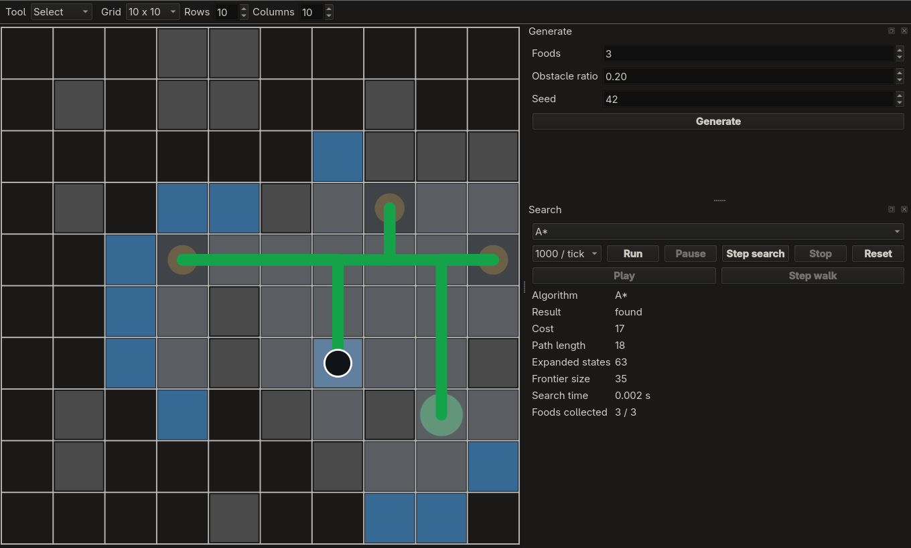
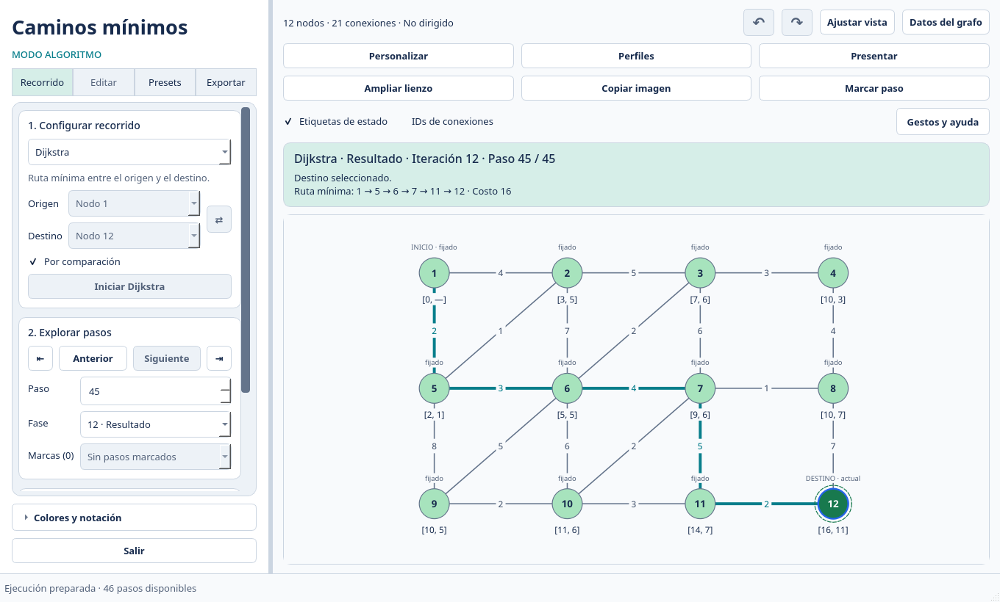
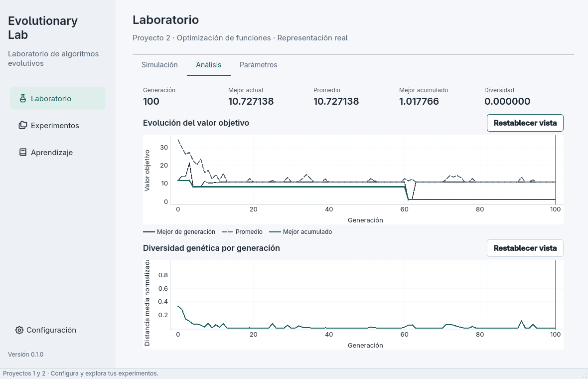
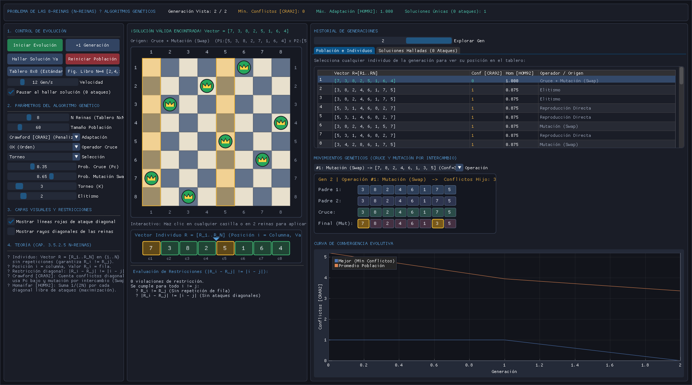
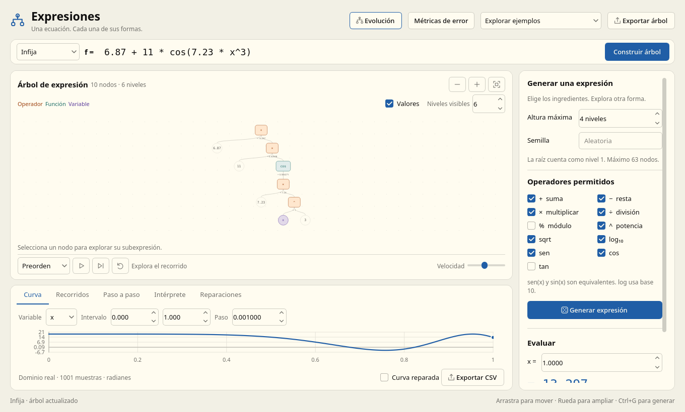

# Fundamentos de Inteligencia Artificial · Unidad 2

**Universidad Politécnica de Victoria**

- **Profesor** Said Polanco Martagón
- **Estudiante** César Euresti
- **Matrícula** 2430233

## Índice de prácticas

| N.º | Práctica | Contenido | Comando de inicio |
| --- | --- | --- | --- |
| 1 | [Problema de la hormiga](01-problema-hormiga/README.md) | Búsqueda de una ruta que recolecte todos los alimentos y alcance la meta. | `uv run --locked ant-pathfinding` |
| 2 | [Visualizador de grafos](02-visualizador-de-grafos/README.md) | Exploración de Dijkstra, A*, Bellman-Ford y Floyd-Warshall paso a paso. | `uv run --locked graph-visualizer` |
| 3 | [Laboratorio de algoritmos evolutivos](03-lab-algoritmos-evolutivos/README.md) | Optimización de funciones con representaciones binarias y reales. | `uv run --locked evolutionary-lab` |
| 4 | [Problema de las N reinas](04-n-reinas/README.md) | Búsqueda de una disposición sin ataques mediante un algoritmo genético. | `uv run --locked n-queens-genalg` |
| 5 | [Árboles de expresión](05-arboles-expresion/README.md) | Construcción de árboles, evaluación de curvas y programación genética. | `uv run --locked expression-tree` |

Cada práctica usa Python 3.12 y `uv`. Ejecuta `uv sync --locked` en su carpeta antes de usar el comando de inicio.

## Capturas de las prácticas

### Problema de la hormiga

### Visualizador de grafos

### Laboratorio de algoritmos evolutivos

### Problema de las N reinas

### Árboles de expresión

